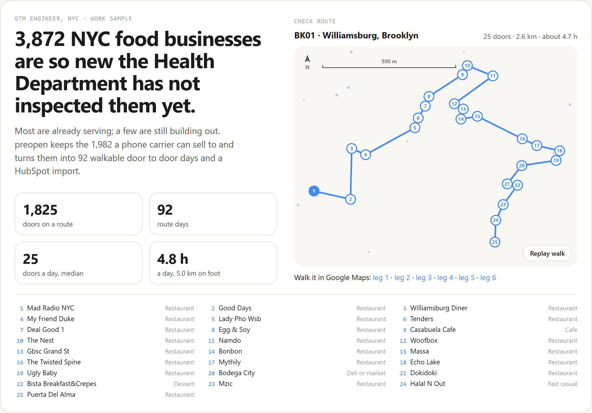
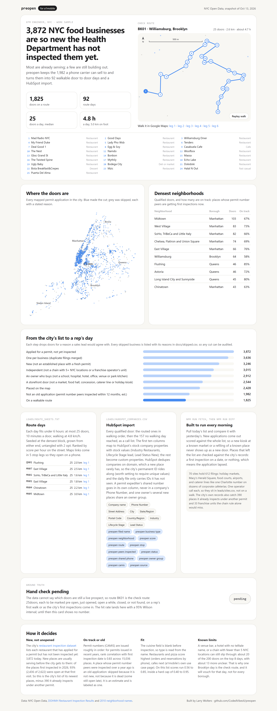

# preopen

**The newest food businesses in New York City, so new the Health Department has not inspected them yet, turned into walkable door to door days and a HubSpot import.** Built as a GTM Engineer work sample for [a1mobile](https://a1mobile.com)'s New York sales team.

**Live card: [codedvibesx.github.io/preopen](https://codedvibesx.github.io/preopen/)** &nbsp; [](https://github.com/CodedVibesX/preopen/actions/workflows/pages.yml) (the badge is green only when the 64 checks pass on the committed data, before every deploy)



## The problem

a1mobile sells a $99 a month business phone line with an AI that answers 24/7, and its own site lists restaurants and cafes first. It is hiring a sales team in New York. The hard part of a city launch is not the pitch, it is the list: which doors should a rep walk today, in what order, and how do those doors get into the CRM without a day of spreadsheet work.

The best door is a restaurant that just opened or is about to. It is setting up everything a business needs right now.

## Where the list comes from

New York City publishes it. The Health Department's [restaurant inspection dataset](https://data.cityofnewyork.us/Health/DOHMH-New-York-City-Restaurant-Inspection-Results/43nn-pn8j) includes, in the city's words, each restaurant "that has applied for a permit but has not yet been inspected". Those rows carry a placeholder inspection date of 1/1/1900. On Oct 13, 2026 there were 3,872 of them.

New places are usually serving before the city gets to them. Of the places the city first inspected in 2026, 2,436 of 2,622 (93%) were open at that first visit, so most of the 3,872 are likely open already. This is not a list of places that have not opened. It is the city's list of its newest places, plus a handful still building out.

The same dataset also holds the other half: 27,661 places the city has already inspected, with name, address, phone and building ID. preopen uses that half to check the new one.

## What preopen does with it

```
 3,872  applied for a permit, not yet inspected
 3,636  one per business (duplicate filings merged)
 3,246  new (not an established place with a fresh permit)
 3,015  independent (not a chain with 5+ NYC locations or a franchise operator's unit)
 2,912  an owner who buys (not a school, hospital, hotel, office, venue or park kitchen)
 2,544  a storefront door (not a market, food hall, concession, caterer line or holiday kiosk)
 2,428  placed on the map
 1,982  not an old application (permit number peers inspected within 12 months, est.)
 1,825  on a walkable route: 92 days, median 25 doors, 5.0 km and 4.8 hours a day
```

Every skipped business is listed with its reasons in [docs/skipped.csv](docs/skipped.csv) (for example, Rudy's Bar & Grill on Ninth Avenue: an established place with a fresh permit, inspected by the city at that address since at least January 2023), so a sales lead can audit any cut.

**Established places, not new ones.** 390 filings belong to a place the city already inspects, found by matching name, address, building ID and phone against the inspected half. 301 are an established business taking out a fresh permit under a new CAMIS, like a Ninth Avenue bar that has been pouring for decades. 37 are already open: the city inspected the same business at the same address under a newer permit, and the old application is a leftover. 52 carry the phone line of a place inspected at the same single storefront: the same operator, or a takeover that kept the number. A place word, a street name or a cuisine never makes two names match ("True North Tribeca" is not "North Bar"), and a different name with its own phone at an old address is a new owner, and stays.

**Franchise units.** Chains count both the places the city inspects and today's filings, because a chain entering New York shows up first as a stack of new applications. Beyond that, 33 filings are franchise units the chain rule alone would miss: their phone sits on inspected stores of a chain elsewhere, and they file under a franchisee's kind of name, like "GCC LEVEL LLC" (five Dunkin stores on the line), "SHREE SHIV OF FOREST AVE INC" or a person's name. An operator opening its own concept, or a small independent group with a few stores on one line, keeps the door with a note saying what else it runs. Names that unrelated owners share (China King, Kennedy Fried Chicken: 78 permits, 68 phone numbers) never count as chains.

**Sites, not doors.** 70 sites hold 612 filings, and walking to any of them finds a kiosk, a lobby or a badge reader. Four or more filings at one address, however it is spelled: the Union Square holiday market, Macy's Herald Square, airports. Five or more at one point on the map in one building: the Bryant Park kiosks file under "42 West 42 Street", "42w 42nd St" and "000 Bryant Park Winter Village" but share one exact point, while a row of storefronts on Steinway Street, each in its own building, is not a site. And one out of town phone number on three or more addresses: a single Charlotte number covers dozens of corporate cafeterias run by one contract caterer. Each filing belongs to at most one site. Sites go to `leads/sites.csv`, one operator call each.

**Hotels and venues.** A new food permit in a building where the city already inspects a room service kitchen, a lobby bar or a concession belongs to the hotel or the venue.

**Expediters and owners.** When one New York number sits on three or more addresses, it is either one owner opening several places (the names share a brand word: one account, many lines, tied together by an owner group) or a permit expediter working for independent owners (the names share nothing: the doors stay, and the number moves to its own column so it never lands in a company's Phone Number).

**On track or old.** An uninspected place has no application date. But permit numbers (CAMIS) are issued roughly in order: for permits issued in recent years, their rank correlation with first inspection date is 0.83 across 15,036 places, recomputed on every run. So preopen knows which permit numbers the city is inspecting this month and places each door against its peers. Peers inspected in the last 3 months: on track. 4 to 12 months ago: behind. Over a year ago: an old application, skipped because it is not new, not because it is dead (some still open late). It is an estimate and is labeled as one everywhere it appears.

**Fit.** The cuisine field is blank before inspection, so type is read from the name. Restaurants and pizza score highest (orders and reservations come in by phone), cafes next (a1mobile has a cafes use case page), juice bars and delis lowest. A door earns call ahead credit only for its own New York number. On this list scores run 0.56 to 0.85, inside a hard cap of 0.40 to 0.95 that never claims certainty.

**Routes.** In each borough a day is seeded at the unrouted door with the most neighbors within 400 m and grown from whichever end has the closer door, until it hits 25 doors or 6 hours (10 minutes a door, walking at 4.8 km/h on a 1.25 street grid factor). A leg over 1.5 km stops the growth. Then 2 opt untangles the order, with either end free to move. Days are ranked by score per hour on the street, so a day of strong fits comes before a day of weak ones.

## What a rep gets

`npm start` writes, from the committed files, in under a second:

* `leads/route_sheets.txt`: each day's doors in walking order, with Google Maps walking links in 5 stop legs, because a phone browser takes at most 3 waypoints. An expediter's number is never printed as the door's phone.
* `leads/hubspot_companies.csv`: every qualified door, the routed ones in walking order and then the 157 no walking day reached, as a call list. The first ten columns are HubSpot's stock company properties with stock option values (Industry `Restaurants`, Lifecycle Stage `lead`, Lead Status `NEW`), so the importer maps them by name. Company name drops the INC or LLC; the name as filed, route, stop, score, status, owner group and the city's permanent ID (CAMIS) come in as custom properties. HubSpot dedupes companies on domain, which a place this new rarely has, so CAMIS is the stable key: worth setting `preopen camis` to require unique values, and the daily file only carries CAMIS numbers it has not seen. Names and addresses that start with `=`, `+`, `-` or `@` are defused so a spreadsheet will not run them as formulas. A sample with phone numbers masked is in [docs/sample_hubspot_import.csv](docs/sample_hubspot_import.csv).
* `leads/sites.csv`: the markets, food halls, concessions and caterer lines, for a call instead of a walk.
* `leads/skipped.csv`: every skipped business with its reasons; the committed copy in `docs/` leaves out phone numbers.
* `app/card.json`: the data behind the card below. It carries no phone numbers, and a test reads the file to make sure.

## Built to run every morning

```
npm run fetch    # today's uninspected list plus the inspected places reference, from NYC Open Data
npm run diff     # compare with the previous snapshot
```

`fetch` refreshes every input the engine reads, and saves nothing new when the city has not published since the last snapshot. New applications are scored against the whole current list, so a new kiosk at a known market stays a site and a refiling of a door already imported is not counted as new (a refiling of a place that was skipped gets judged fresh). They come out in the same HubSpot format as `leads/new_doors_<date>.csv`. Places that left the list go to `leads/left_list_<date>.csv`, each checked against the city's records by the CAMIS that left: its first inspection on a date (and whether the place was already operating), the same business inspected under another permit at that address or building, or nothing, which means the application lapsed or was withdrawn. The repo holds one snapshot so far; the diff starts working with the second.

## Ground truth: pending

The data cannot say which doors are still a live prospect, so one route is the check route: BK01, 25 doors around Bedford Avenue, Grand Street and Havemeyer Street in Williamsburg. A rep's first walk marks each door `pre_open`, `just_opened`, `open_old`, `closed` or `not_found` in `validation/walk.csv`, and `npm run walk` reports the hit rate with a 95% Wilson interval; meanwhile the daily diff records, door by door, when the city first inspects each one and whether it was already operating. Only doors on the reported route count, once each, so a recheck or an older route can never inflate it. Until there is a result, the card and this README show no number.

## The card



A static Next.js page in a1mobile's own palette. One animation: the hand check route draws itself and each door lights up as the walk reaches it.

## Known limits

* Reading the 200 doors on the top 8 route days by hand, about 20 should not be there: a venue or hotel bar with no telltale name (Magic Mike Live, Row NYC), a chain with fewer than 5 NYC stores or a franchise (Ledo Pizza, Kilwins, Brooklyn Dumpling Shop), or a holding company name with nothing to judge (Kalhar Capital, Formax Group). About 13 more are unclear: a person's name on the permit, an out of state phone. The Second Avenue and Nolita days read clean; most of the misses sit on the Midtown, Hell's Kitchen and Flushing days.
* Type comes from the name, so 1,400 of the 1,982 qualified places have plain names that default to the restaurant type.
* The out of town phone rule is a heuristic: a New Jersey expediter would be read as a caterer line and its doors skipped.
* The established place match reads the city's inspection records, which reach back about three years, so "since at least" is the honest reading of the dates. An office tower's employee cafeteria does not mark its building, because the same building often holds real street level restaurants; a corporate kitchen with no telltale name can slip through.
* The check route will vouch for one Brooklyn day, not for the Manhattan days at the top of the list.
* Walking distance is straight line times a grid factor, not a street network.

## Next, with Clay

Enrich each door from its Google Maps listing: website (a domain for HubSpot to dedupe on), business status and hours. That confirms open or not yet open at scale, instead of one walked route at a time.

## Run it

```
npm install
npm start          # score, route and export from the committed files
npm test           # unit tests plus invariants on the real snapshot
npm run dev        # the card on http://localhost:3007
npm run shots      # screenshots, plus checks for dashes, phone overflow and console errors
```

Node 20.9 or newer (Next.js 16 needs it). The engine is TypeScript in `src/`, run with tsx. No API keys: NYC Open Data is public.

## Data

NYC Open Data: [DOHMH New York City Restaurant Inspection Results](https://data.cityofnewyork.us/Health/DOHMH-New-York-City-Restaurant-Inspection-Results/43nn-pn8j) for the uninspected list and for the inspected places (names, addresses, phones, building IDs and inspection dates), and the [2010 Census Tract to Neighborhood Tabulation Area table](https://data.cityofnewyork.us/City-Government/2010-Census-Tract-to-Neighborhood-Tabulation-Area-/8ius-dhrr) for neighborhood names.

Built by Larry Wolters.
